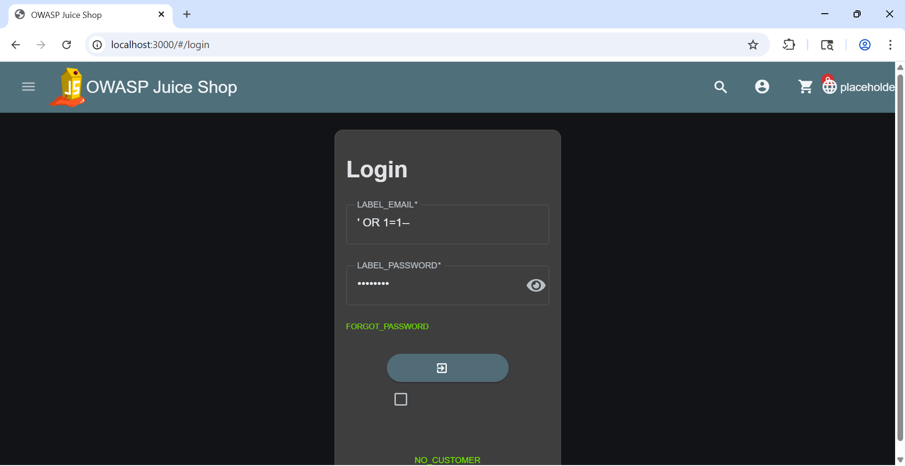
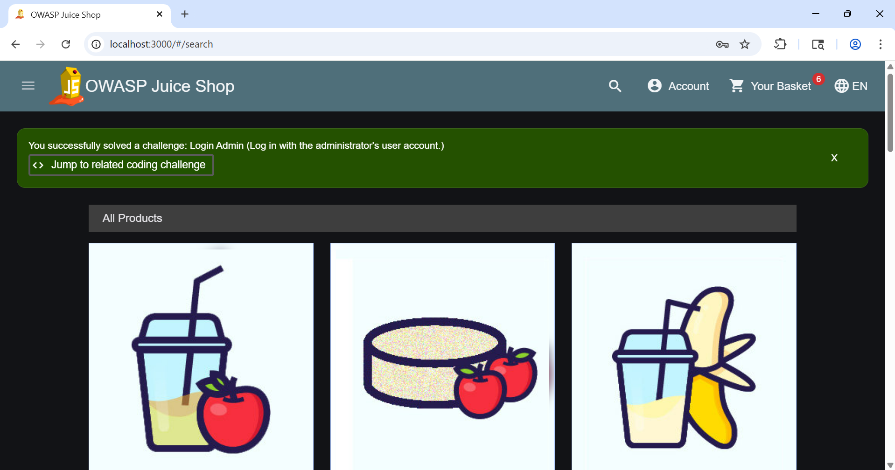
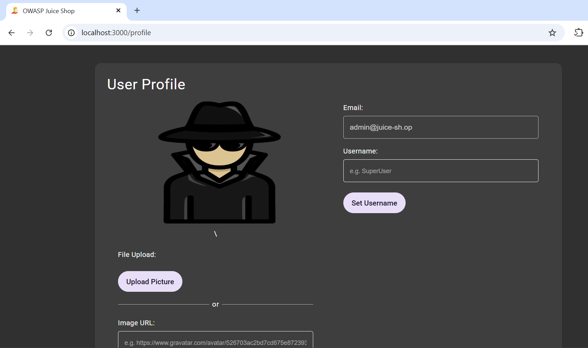
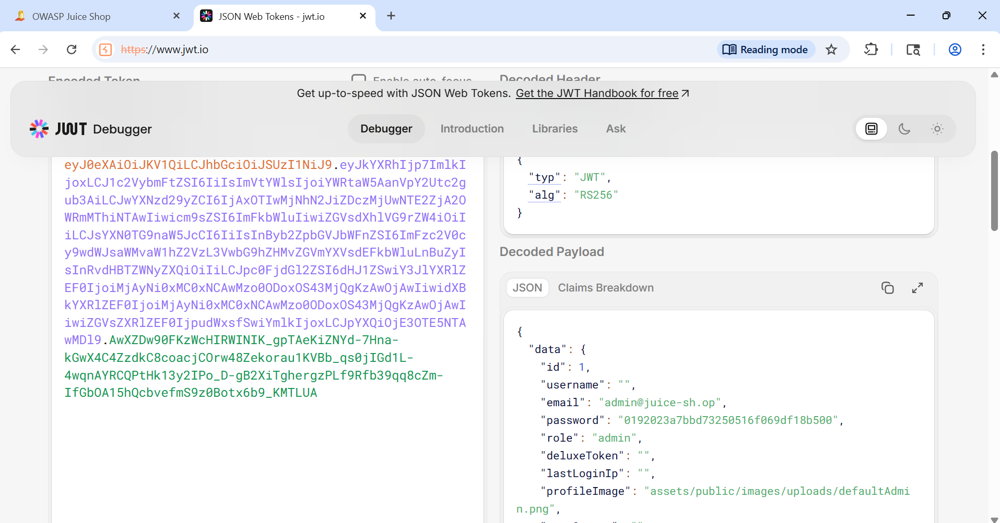
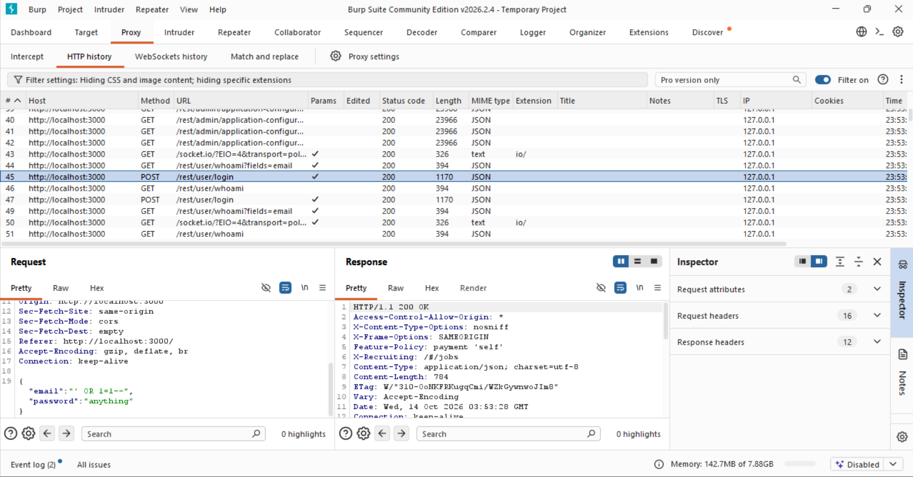

# [F-01] SQL Injection — Authentication Bypass

**Severity:** Critical
**CVSS Score:** 9.8
**CVSS Vector:** CVSS:3.1/AV:N/AC:L/PR:N/UI:N/S:U/C:H/I:H/A:H
**OWASP Category:** A03:2021 — Injection
**CWE:** CWE-89 — Improper Neutralization of Special Elements in SQL Command
**Target:** http://localhost:3000/#/login
**Endpoint:** POST /rest/user/login
**Date Tested:** 2026-10-13

---

## Description
The login endpoint fails to sanitize user-supplied input before 
constructing SQL queries. An attacker can inject SQL syntax into 
the email field to manipulate the WHERE clause, bypassing 
authentication entirely and gaining unauthorized access to any 
account — including the administrative account.

## Steps to Reproduce
1. Navigate to `http://localhost:3000/#/login`
2. Enter the following in the Email field: `' OR 1=1--`
3. Enter any value in the Password field
4. Click the Login button
5. Application authenticates the request and returns a valid JWT 
   token for `admin@juice-sh.op`

## Evidence

*Attacker enters `' OR 1=1--` in the email field with arbitrary password*

*Green banner confirms: "You successfully solved a challenge: Login Admin"*

*Application grants full admin session — profile confirms admin@juice-sh.op*

*Decoded JWT confirms role:admin. Password hash (MD5) also exposed in token payload.*

*Burp HTTP History: POST /rest/user/login returns 200 OK with SQLi payload in request body*

## Impact
An unauthenticated attacker can log in as any user including 
administrators without knowing credentials. Decoded JWT reveals:
- Full admin role access granted
- Admin email address exposed
- Password hash (MD5) exposed in token payload

In a production banking environment this constitutes a complete 
authentication control failure, enabling account takeover, 
data exfiltration, and full application compromise.

## Remediation
- Use parameterized queries / prepared statements exclusively
- Implement server-side input validation and allowlist filtering
- Remove sensitive fields (password hash) from JWT payload
- Deploy WAF rules to block common SQLi patterns
- Reference: [OWASP SQL Injection Prevention Cheat Sheet](https://cheatsheetseries.owasp.org/cheatsheets/SQL_Injection_Prevention_Cheat_Sheet.html)

## References
- CWE-89: https://cwe.mitre.org/data/definitions/89.html
- OWASP A03:2021: https://owasp.org/Top10/A03_2021-Injection/