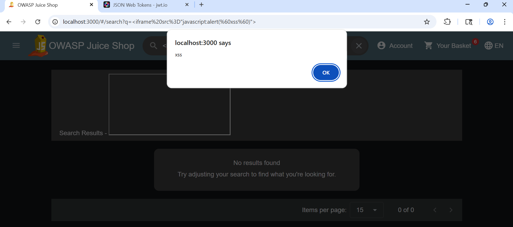
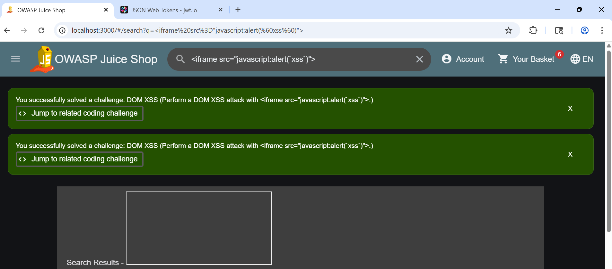
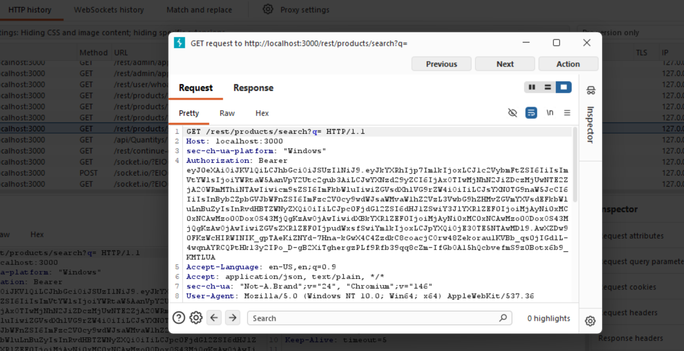

# [F-02] Cross-Site Scripting (XSS) — DOM & Stored

**Severity:** High
**CVSS Score:** 7.5
**CVSS Vector:** CVSS:3.1/AV:N/AC:L/PR:N/UI:R/S:C/C:H/I:L/A:N
**OWASP Category:** A03:2021 — Injection
**CWE:** CWE-79 — Improper Neutralization of Input During Web Page Generation
**Target:** http://localhost:3000
**Endpoints:**
- GET /rest/products/search?q= (DOM XSS)
- POST /api/Products/:id/reviews (Stored XSS)
**Date Tested:** 2026-10-14

---

## Description
Two XSS vulnerabilities were identified in OWASP Juice Shop.
First, the search functionality reflects unsanitized user input
directly into the DOM, allowing JavaScript execution via a
crafted URL. Second, the product review endpoint stores
unsanitized HTML/JavaScript input in the database, which
persists across sessions and affects all users viewing
that product.

## Attack 1 — DOM-Based XSS (Search Bar)

### Steps to Reproduce
1. Navigate to `http://localhost:3000`
2. Enter the following in the search bar:
   `<iframe src="javascript:alert(`xss`)">`
3. Press Enter
4. Observe: JavaScript executes immediately — alert box fires
   with message "xss" from localhost:3000
5. URL reflects payload:
   `localhost:3000/#/search?q=<iframe src="javascript:alert(`xss`)">`

## Attack 2 — Stored XSS (Product Reviews)

### Steps to Reproduce
1. Log in to the application
2. Navigate to any product (e.g., Apple Juice 1000ml)
3. In the review text field enter:
   `<iframe src="javascript:alert(`XSS`)">`
4. Submit the review
5. Observe: Raw HTML tag is stored in the database and
   rendered as text — input reaches the database unsanitized

## Evidence

*Alert box fires from localhost:3000 confirming JavaScript
execution via search parameter*

*Juice Shop confirms: "DOM XSS — Perform a DOM XSS attack
with iframe src=javascript:alert(`xss`)". Iframe rendered
in search bar.*

*XSS payload `<iframe src="javascript:alert(`XSS`)">` stored
in product reviews under admin@juice-sh.op — persists across
page loads*

*Burp Suite HTTP History: GET /rest/products/search?q= with
unsanitized iframe payload in query parameter*

## Impact
An attacker can craft a malicious URL and trick authenticated
users into clicking it, executing arbitrary JavaScript in their
browser context. This enables session token theft, credential
harvesting, and account takeover. The stored variant affects
every user viewing the compromised product page without
any interaction beyond page load.

## Remediation
- Encode all user-supplied output before rendering in the DOM
- Implement a strict Content Security Policy (CSP) header
- Use Angular's built-in DomSanitizer for dynamic content
- Validate and sanitize review input server-side before storage
- Reference: [OWASP XSS Prevention Cheat Sheet](https://cheatsheetseries.owasp.org/cheatsheets/Cross_Site_Scripting_Prevention_Cheat_Sheet.html)

## References
- CWE-79: https://cwe.mitre.org/data/definitions/79.html
- OWASP A03:2021: https://owasp.org/Top10/A03_2021-Injection/